<!-- HEADER -->

<!-- ANIMATED TYPING -->

  

  

<!-- TECH STACK -->
<h2>TECH STACK</h2>

 

  

<h2>GITHUB ANALYTICS</h2>

  

<h2>PROBLEM SOLVING</h2>

  

<h2>FEATURED PROJECTS</h2>

 

<!-- CONTRIBUTION GRAPH -->
<h2>CONTRIBUTION ACTIVITY</h2>

  

<!-- PROJECTS -->
<h2>FEATURED PROJECTS</h2>

  

<!-- VISITOR COUNT -->

 

<!-- FOOTER -->

