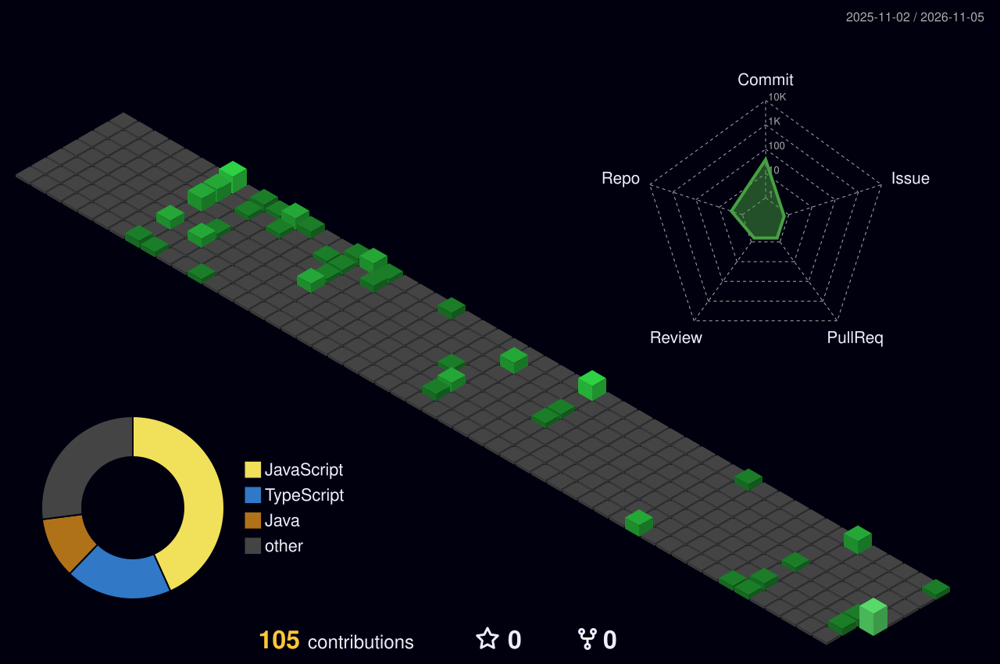

<!--
  ============================================
       DaHeeO | BLACK × SOFT NEON GREEN
  ============================================
-->

<!-- HEADER -->

 

<!-- TYPING ANIMATION -->

  

<!-- CONTACT -->

&nbsp;

   

<!-- ============================================
     TECH STACK
============================================ -->

 

 

   

<!-- ============================================
     CONTRIBUTION GARDEN
============================================ -->

 

   

<!-- ============================================
     PROBLEM SOLVING
============================================ -->

 

   

<!-- ============================================
     FEATURED PROJECTS
============================================ -->

 

  

  

   

<!-- ============================================
     FOOTER
============================================ -->

  

